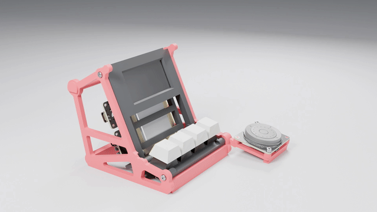
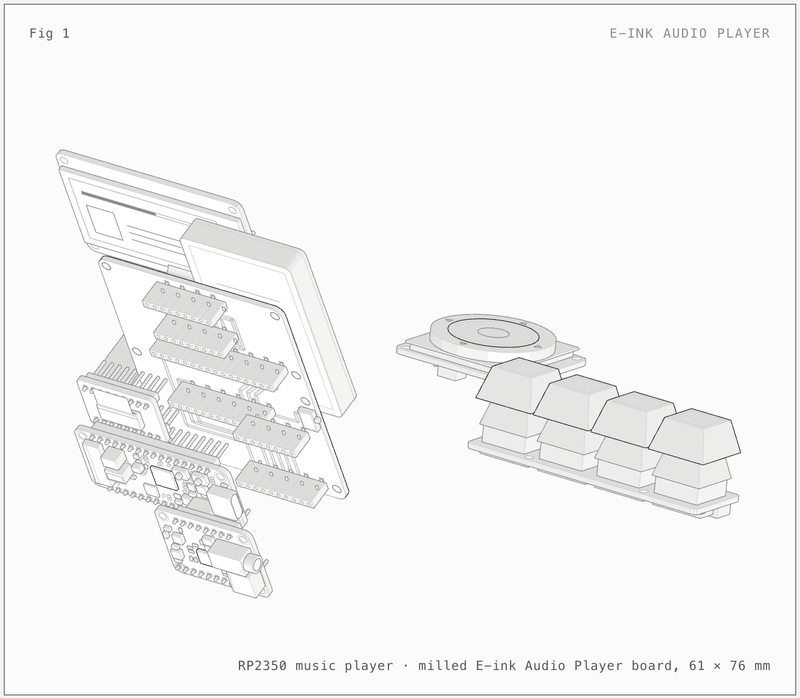
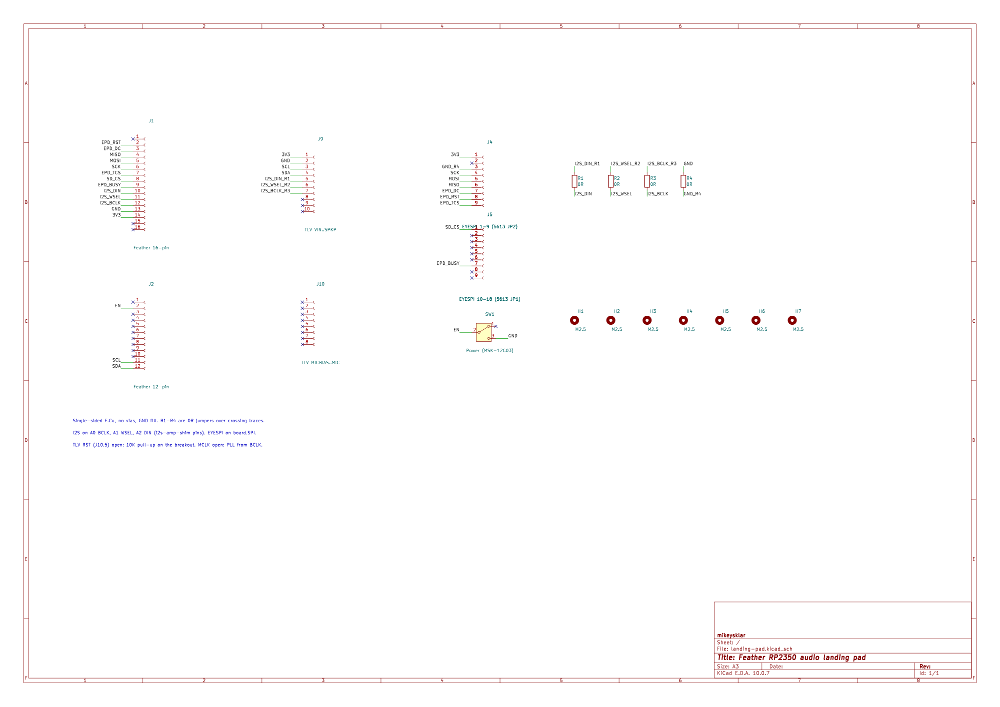
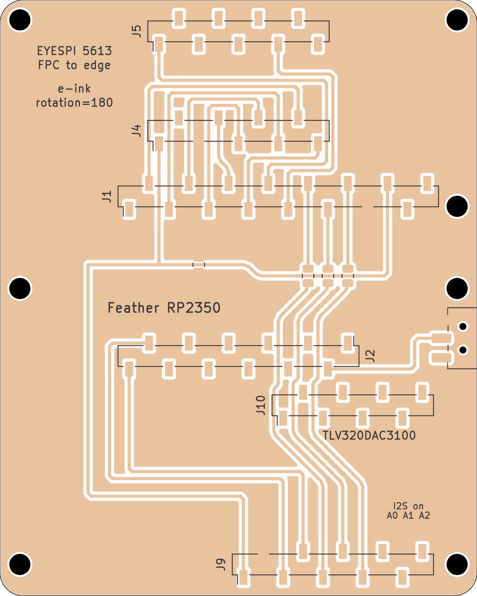
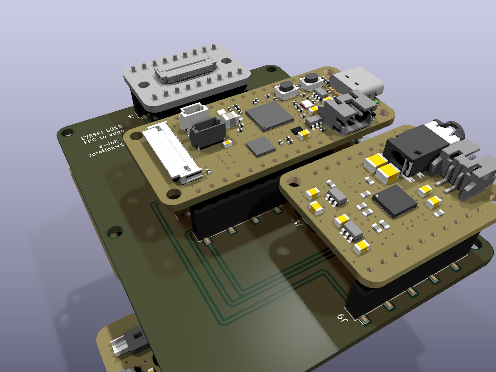
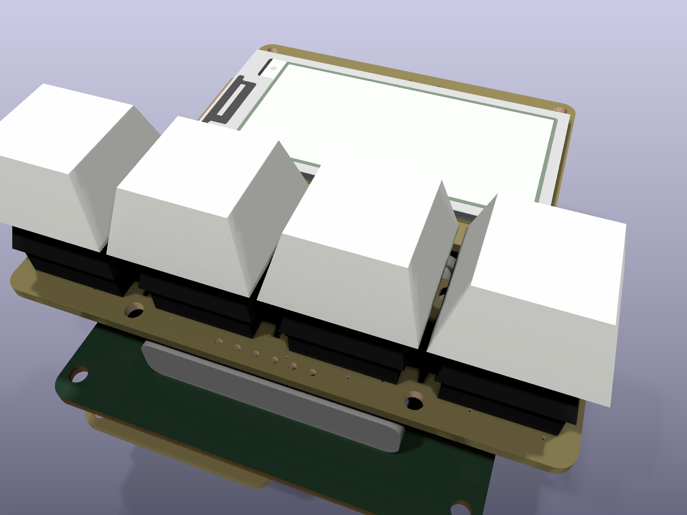
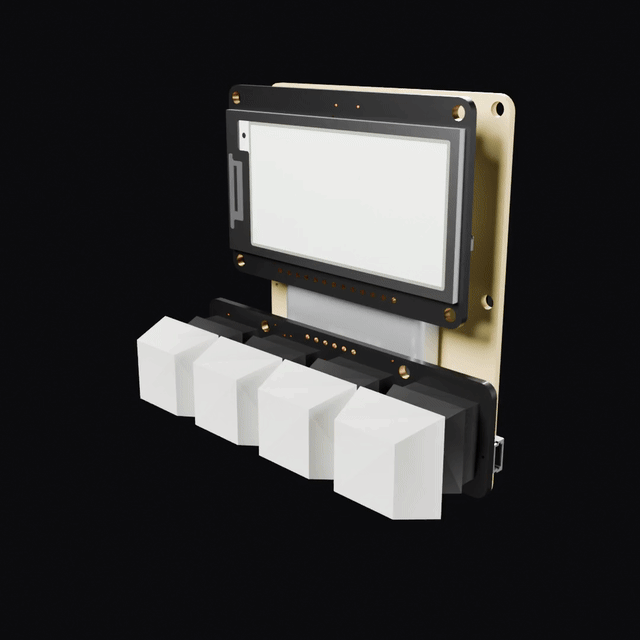
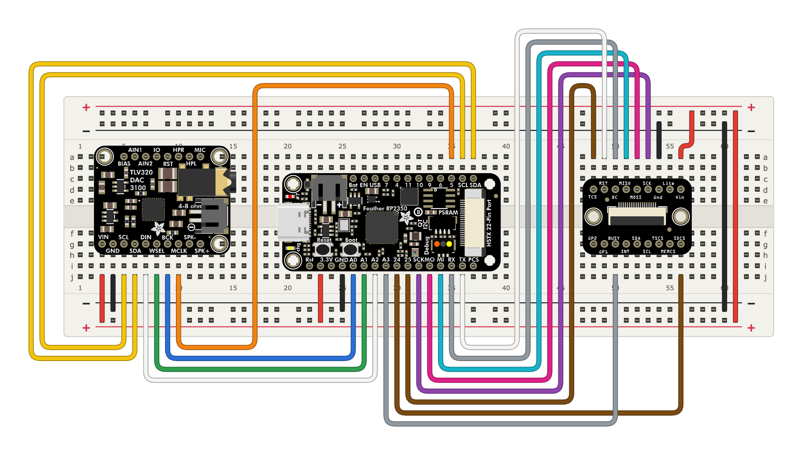
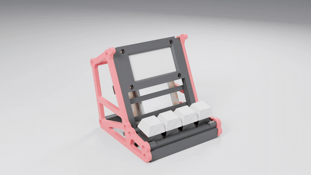
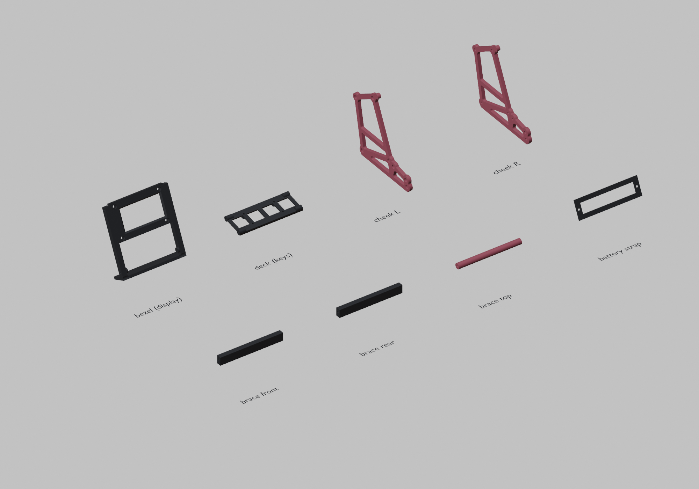

# Frisson

A desktop audio player with a quad-colour e-ink screen, four keys and a thumb wheel. It will let you pick a letter to jump straight to an artist, album or song, so you never scroll through a long list.

It plays FLAC files. 16-bit/44.1 kHz works now; the goal is up to 24-bit/96 kHz, higher quality than a CD. Some people get frisson, a chill or goose bumps on the neck, from music they love, and that slightly better fidelity can make it easier to feel.

Site: https://mikeysklar.github.io/frisson/

Docs: [Hardware](docs/HARDWARE.md) · [Design](docs/DESIGN.md) · [Printing](docs/PRINTING.md)





Parts are labelled in the [interactive anatomy page](https://mikeysklar.github.io/frisson/anatomy.html).

## How it works

- An Adafruit Feather RP2350 reads FLAC files from a microSD card on the display's EYESPI breakout, over SPI.
- A TLV320DAC3100 DAC takes I2S from the Feather on A0, A1 and A2, and drives the headphone jack. A jumper wire from TP1 to TP2 feeds it a 15 MHz MCLK from D5; without it the audio sounds muffled.
- The 2.13 inch quad-colour e-ink screen shows the artist and track.
- A NeoKey 1x4 on STEMMA QT gives next, previous, play and artist.
- An ANO rotary encoder on the stand gives the thumb a wheel and five buttons. It chains off the NeoKey over STEMMA QT.
- A 2000 mAh LiPo powers it. A slide switch turns it on and off.

## The board

The four boards plug into one single-sided milled PCB. It has top copper only, 0.4 mm traces, a GND fill with 0.1 mm clearance, and 0805 0R jumpers where traces cross. There are no vias. Two large pads, TP1 and TP2, take a hand-soldered wire from Feather D5 to the TLV320's MCLK.











- `kicad/` has the KiCad project and the 3D models it uses. The ANO is in it too, as a reference part off the board, where the stand puts it.
- `kicad/3d/adafruit-hq/` rebuilds the board models: Adafruit's CAD parts on Adafruit's own boards, with mask, silkscreen and pads.
- `kicad/fab/` has the Gerber and drill files for milling or a board house.
- `kicad/scripts/` has the scripts that generate the board and check the layout plan.

Without the landing pad, the same circuit on a breadboard takes 22 jumper wires:



## Firmware

`firmware/` is a CircuitPython FLAC player with e-ink menus, up to 24-bit / 96 kHz. Browse with the ANO wheel and NeoKeys, or search by typing chords. See [firmware/README.md](firmware/README.md) for the jumper, pins, libraries and controls.

## The stand

A minimal "mini arcade" skeleton. The screen tilts back 65 degrees. The keys sit on their own deck in front, at 10 degrees. It is five printed parts held by 12 M2.5 screws into brass heat inserts, so it comes apart and goes back together easily. The red chassis is both cheeks, the feet and the ANO mount in one piece. The ANO sits past the end of the keys, closer to you, for the thumb.





- `enclosure/` has the FreeCAD scripts, STEP and STL files, and `frisson.FCStd`.
- To rebuild the stand, run `freecadcmd enclosure/assemble_arcade.py`.

## Parts

| Part | Adafruit PID |
| --- | --- |
| [Feather RP2350](https://www.adafruit.com/product/6000) | 6000 |
| [TLV320DAC3100 I2S DAC](https://www.adafruit.com/product/6309) | 6309 |
| [2.13 inch quad-colour e-ink display](https://www.adafruit.com/product/6366) | 6366 |
| [EYESPI breakout](https://www.adafruit.com/product/5613) | 5613 |
| [NeoKey 1x4](https://www.adafruit.com/product/4980) | 4980 |
| [LiPo 2000 mAh](https://www.adafruit.com/product/2011) | 2011 |
| [ANO rotary encoder, I2C](https://www.adafruit.com/product/6310) | 6310 |

Full parts list, pin map and screws: [docs/HARDWARE.md](docs/HARDWARE.md).

## Renders

- `blender/` has the scene scripts for the turntable and explode renders. It follows the Metal GPU Cycles recipe.
- `anatomy/` has the sources for the anatomy figure. Rebuilding it needs the [Anatomy kit](https://skills.wheresryan.sh/anatomy).

## Layout

```
README.md
LICENSE
.gitignore
docs/          Pages site, renders, anatomy page and docs
kicad/         KiCad project, 3D models, fab files and generator scripts
enclosure/     FreeCAD sources, STEP and STL files
blender/       render scripts and scenes
anatomy/       anatomy build sources
```

## License

MIT-0 (MIT No Attribution). See [LICENSE](LICENSE).
