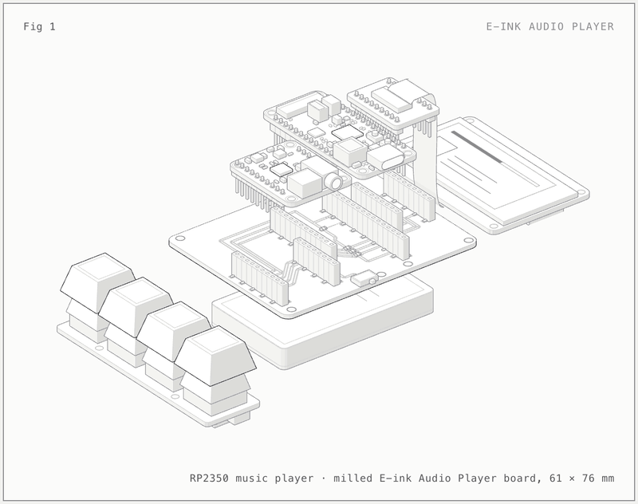
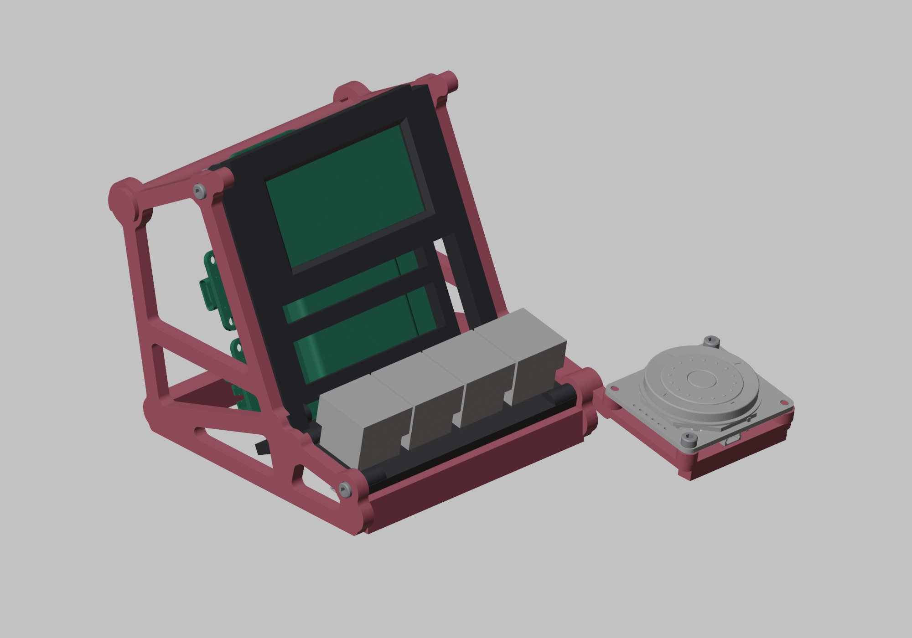

# eink-audio-player

A palm-sized MP3 player with a 2.13 inch e-ink screen and four physical keys. Site: https://mikeysklar.github.io/eink-audio-player/

Docs: [Hardware](docs/HARDWARE.md) · [Design](docs/DESIGN.md) · [Printing](docs/PRINTING.md)




Parts are labelled in the [interactive anatomy page](https://mikeysklar.github.io/eink-audio-player/anatomy.html).

## How it works

- An Adafruit Feather RP2350 reads MP3 files from a microSD card on the display's EYESPI breakout, over SPI.
- A TLV320DAC3100 DAC takes I2S from the Feather on A0, A1 and A2, and drives the headphone jack.
- The 2.13 inch quad-colour e-ink screen shows the artist and track.
- A NeoKey 1x4 on STEMMA QT gives next, previous, play and artist.
- A 2000 mAh LiPo powers it. A slide switch turns it on and off.

## The board

The four boards plug into one single-sided milled PCB. It has top copper only, 0.4 mm traces, a GND fill with 0.1 mm clearance, and 0805 0R jumpers where traces cross. There are no vias.


- `kicad/` has the KiCad project and the 3D models it uses.
- `kicad/fab/` has the Gerber and drill files for milling or a board house.
- `kicad/scripts/` has the scripts that generate the board and check the layout plan.

## The stand

A minimal "mini arcade" skeleton. The screen tilts back 65 degrees. The keys sit on their own deck in front, at 10 degrees. Two red cheeks join the parts, held with M2.5 screws.





- `enclosure/` has the FreeCAD scripts, STEP and STL files, and `eink-audio-player.FCStd`.
- To rebuild the stand, run `freecadcmd enclosure/assemble_arcade.py`.

## Parts

| Part | Adafruit PID |
| --- | --- |
| [Feather RP2350](https://www.adafruit.com/product/6000) | 6000 |
| [TLV320DAC3100 I2S DAC](https://www.adafruit.com/product/6309) | 6309 |
| [2.13 inch quad-colour e-ink display](https://www.adafruit.com/product/6366) | 6366 |
| [EYESPI breakout](https://www.adafruit.com/product/5613) | 5613 |
| [NeoKey 1x4](https://www.adafruit.com/product/4980) | 4980 |
| [LiPo 2000 mAh](https://www.adafruit.com/product/2011) | 2011 |

Full parts list, pin map and screws: [docs/HARDWARE.md](docs/HARDWARE.md).

## Renders

- `blender/` has the scene scripts for the turntable and explode renders. It follows the Metal GPU Cycles recipe.
- `anatomy/` has the sources for the anatomy figure. Rebuilding it needs the [Anatomy kit](https://skills.wheresryan.sh/anatomy).

## Layout

```
README.md
LICENSE
.gitignore
docs/          Pages site, renders, anatomy page and docs
kicad/         KiCad project, 3D models, fab files and generator scripts
enclosure/     FreeCAD sources, STEP and STL files
blender/       render scripts and scenes
anatomy/       anatomy build sources
```

## License

MIT-0 (MIT No Attribution). See [LICENSE](LICENSE).
